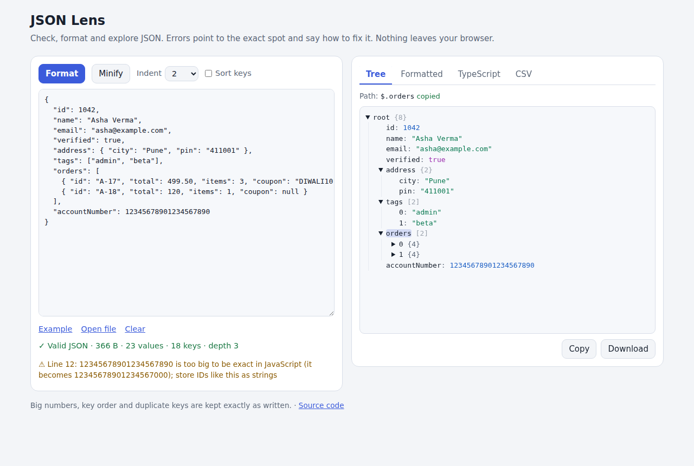

# JSON Lens

[](https://github.com/Sumitrcs/json-lens/actions/workflows/ci.yml) 

**A JSON validator, formatter and explorer with error messages written for people.** Paste JSON and it tells you whether it's valid, and if it isn't, *exactly where* the problem is and *how to fix it*.
You can then browse it as a tree, click any key to copy its path, and turn it into **TypeScript types** or **CSV**.

The JSON parser is written by hand in TypeScript with no dependencies. Everything runs in your browser, so nothing you paste is uploaded.



## Why another JSON tool?

Because `JSON.parse` error messages don't help when you're learning:

```text
Input                          JSON.parse says                                        JSON Lens says
{"tags": ["admin", "beta",]}   Unexpected token ']', ..."", "beta",]}" is not         Trailing comma before ] (line 1, column 26)
                               valid JSON                                             Fix: Remove the comma after the last item: JSON doesn't allow one

{ name: "Asha" }               Expected property name or '}' in JSON at position 2    Key "name" is not in quotes (line 1, column 3)
                                                                                      Fix: In JSON every key needs double quotes: "name": ...

{"active": True}               Unexpected token 'T', "{"active": True}" is not        Unexpected word "True" (line 1, column 12)
                               valid JSON                                             Fix: JSON booleans are lower case: true

{"path": "C:\Users\asha"}      Bad escaped character in JSON at position 13           Invalid escape \U (line 1, column 13)
                                                                                      Fix: ... For a backslash itself write \\ (common in Windows paths)

{"pin": 0411}                  Unexpected number in JSON at position 9                Numbers can't have leading zeros (line 1, column 9)
                                                                                      Fix: ... If it's a code like a PIN or phone number, make it a string: "07"
```

The web page also shows the line with a `^` under the problem, and a button that jumps to it in the editor.
It recognises the mistakes people really make: trailing commas, single quotes, unquoted keys, comments, Python's `True`/`None`, `undefined`, `NaN`, leading zeros, a missing comma or colon, the wrong closing bracket, an unclosed string, a raw line break or tab inside a string, and two documents pasted one after another.

It also **warns** about things that are valid but probably wrong:

- **Duplicate keys.** `{"id": 1, "id": 2}` is allowed, but most programs silently keep only the last one.
- **Numbers too big for JavaScript.** `12345678901234567890` becomes `12345678901234567000` in `JSON.parse`. JSON Lens keeps the exact digits when formatting and suggests storing IDs like this as strings.
- **An invisible byte order mark** at the start of the file, which some Windows editors add and many parsers reject.

## Features

| | |
|---|---|
| **Validate** | Live, as you type, with line, column and a suggested fix |
| **Format / Minify** | 2 spaces, 4 spaces or tabs; optional *sort keys* (recursive) |
| **Tree view** | Expand and collapse; click a key to copy its path, like `$.orders[0].total` |
| **TypeScript** | Interfaces generated from the data, with optional keys and `null` unions |
| **CSV** | An array of objects becomes a spreadsheet, with nested keys flattened |
| **Exact** | Numbers, key order and escapes are kept as written |
| **Big files** | Tree nodes are built only when opened, 200 children at a time |

### TypeScript types from data

```json
[
  {"id": 1, "name": "Asha", "address": {"city": "Pune"}, "tags": ["admin"]},
  {"id": 2, "name": "Ravi", "address": {"city": "Delhi"}, "tags": [], "phone": null},
  {"id": 3, "name": "Meera", "address": {"city": "Kochi", "pin": "682001"}, "tags": ["beta", "qa"], "phone": "98xxxxxx01"}
]
```

becomes

```ts
export type Users = User[];

export interface User {
  id: number;
  name: string;
  address: Address;
  tags: string[];
  phone?: string | null;
}

export interface Address {
  city: string;
  pin?: string;
}
```

`phone` is optional because the first user doesn't have it, and `string | null` because one value is a string and one is `null`.

### CSV

The same data as CSV, ready for Excel or Google Sheets:

```text
id,name,address.city,tags,phone,address.pin
1,Asha,Pune,admin,,
2,Ravi,Delhi,,,
3,Meera,Kochi,beta; qa,98xxxxxx01,682001
```

## Run it

It's a static page. Open it through any local web server:

```bash
npx serve .           # then open http://localhost:3000
npm test              # 72 tests
node build.mjs        # rebuild dist/ after editing src/
```

The parser can also be used from Node (22.18 or newer runs `.ts` files directly):

```ts
import { parse, JsonError } from "./src/parse.ts";
try {
  const { root, warnings } = parse(text);
} catch (e) {
  if (e instanceof JsonError) console.log(e.line, e.col, e.message, e.hint);
}
```

## How it works

```text
src/parse.ts    text → syntax tree, with error positions and hints
src/format.ts   syntax tree → text (pretty or minified, optionally sorted)
src/types.ts    syntax tree → TypeScript interfaces
src/csv.ts      syntax tree → CSV
src/app.ts      the page: wires the textarea, tabs and tree together
```

### 1. A recursive-descent parser

JSON's grammar is small enough to fit on a business card, and each rule becomes one method:

```text
value   := object | array | string | number | true | false | null
object  := '{' ( string ':' value ( ',' string ':' value )* )? '}'
array   := '[' ( value ( ',' value )* )? ']'
```

`value()` looks at one character to decide what comes next: `{` means an object, `[` an array, `"` a string, `-` or a digit a number.
`object()` and `array()` call `value()` for their contents, so nesting is handled by recursion. The parser keeps a single index (`pos`) into the text and only moves forward, so it runs in linear time.

### 2. Errors that know what you meant

A plain parser only knows "I expected X and found Y". Good messages come from looking at **what was found, in what context**:

- found `}` where a key should be, right after a comma → a *trailing comma*, and the error points at the comma;
- found a letter where a key should be → an *unquoted key*;
- found a word where a value should be → look it up: `True` → "lower case: true", `None` → "use null";
- found `"` where a `,` should be → a *missing comma*;
- reached the end inside `{` → "the `{` at line 4, column 3 is never closed", which is far more useful than "unexpected end".

Line and column are only computed when there *is* an error, by counting newlines up to the error's offset, so valid input pays nothing for them.

### 3. A syntax tree instead of JavaScript values

`JSON.parse` returns JavaScript objects, and that loses information: big numbers are rounded, `1.50` becomes `1.5`, and number-like keys are moved to the front (`{"b":1, "2":0}` comes back as `{"2":0, "b":1}`).
JSON Lens builds a small tree instead, where a number keeps its original text and an object is a *list* of entries. Formatting walks that tree, so the only thing that changes is whitespace.

### 4. Inferring types

Every value gets a *shape*, and the shapes of all the items in an array are **merged**:

```text
merge({id: number}, {id: number, phone: string})  →  {id: number, phone?: string}
merge(string, null)                               →  string | null
merge(number[], [])                               →  number[]
```

Each object shape is then named after its key (`orders` → `Order`, `categories` → `Category`) and printed as an interface. Identical shapes share one interface.

### 5. Tested against the real thing

The parser is checked against the JavaScript engine's own `JSON.parse`:

- **5,000 random valid documents** (with escapes, emoji, surrogate pairs, odd numbers and whitespace) must produce exactly the same values;
- **20,000 randomly broken documents** (a character deleted, inserted or doubled) must be **accepted or rejected exactly when `JSON.parse` does**.

The formatter is checked against `JSON.stringify` the same way. On top of that there are 42 tests that pin the line, column, message and hint for specific mistakes.

## What you'll learn

- How a parser works: grammar → recursive descent, one function per rule
- Writing error messages that help: context-aware hints, positions, pointing at the real cause
- Why `JSON.parse` loses precision (IEEE 754 doubles, `Number.MAX_SAFE_INTEGER`) and how to avoid it
- Unicode details: `\uXXXX` escapes, surrogate pairs for emoji, UTF-8 byte counts
- Type inference by merging shapes, the idea behind tools like quicktype
- CSV done properly: RFC 4180 quoting, and why cells starting with `=` are dangerous (CSV injection)
- Differential and fuzz testing: using an existing implementation as the oracle
- A fast UI for big data: lazy rendering of tree nodes

## Try it yourself

1. **JSON5 mode.** Add an option that *accepts* comments, trailing commas and unquoted keys (the parser already detects all three).
2. **Search.** Add a box that filters the tree to keys or values matching a text, and opens the path to each match.
3. **Path queries.** Let users type `$.orders[*].total` and list the matching values.
4. **Diff.** Paste two documents and show which paths were added, removed or changed.
5. **Zod schemas.** Add a third generator next to TypeScript and CSV that writes a Zod schema from the same inferred shapes.

## License

MIT © Sumit ([@Sumitrcs](https://github.com/Sumitrcs))
