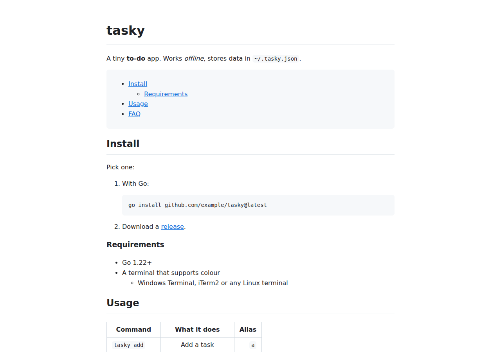

# mdlite

[](https://github.com/Sumitrcs/mdlite/actions/workflows/ci.yml) 

A Markdown-to-HTML converter written from scratch in Go, with no dependencies.
It is small enough to read in an evening and solid enough to use.
It covers the Markdown people actually write, including GitHub-style tables, strikethrough and a table of contents, and the output is **safe** to put on a web page.

```bash
go install github.com/Sumitrcs/mdlite/cmd/mdlite@latest

mdlite README.md > readme.html             # HTML fragment
mdlite -page -toc notes.md -o notes.html   # complete page with styles and contents
cat post.md | mdlite                       # reads standard input
```



## What it supports

| Blocks | Inline |
|--------|--------|
| `#` headings and `===` / `---` underlined headings | `*em*` `_em_` `**strong**` `__strong__` `~~strike~~` |
| Paragraphs, `---` rules | `` `code` ``, with double backticks for code containing a backtick |
| Bulleted and numbered lists, nested, tight or loose | `[links](url "title")` and `` |
| `>` quotes (nested) | `<https://autolinks>` and `<me@email.in>` |
| ```` ``` ```` and `~~~` fenced code with a language class | `\*` backslash escapes, hard line breaks |
| Tables with `:--`, `:-:` and `--:` alignment | Unicode everywhere: नमस्ते *दुनिया* 😀 |

Every heading gets an `id` (`## Getting started` → `id="getting-started"`, the same way GitHub does it). Add `-toc` to get a linked table of contents at a `[TOC]` line.

As a library:

```go
html := mdlite.ToHTML("# Hello\n\nSome *Markdown*.")
html  = mdlite.Render(src, mdlite.Options{TOC: true})
for _, h := range mdlite.Parse(src).Headings { fmt.Println(h.Level, h.ID, h.Text) }
```

## Safe by default

Markdown often comes from users (comments, issues, wiki pages), so the output must never run their code:

```text
$ printf '[Click me](javascript:alert(1)) <script>alert(1)</script>\n' | mdlite
<p>Click me &lt;script&gt;alert(1)&lt;/script&gt;</p>
```

- Raw HTML is escaped, never passed through.
- Links and images may only use `http`, `https`, `mailto`, `ftp`, `tel` or relative URLs. `javascript:`, `data:` and similar schemes are dropped. So are tricks like `JaVaScRiPt:` or `java<TAB>script:`, which browsers would still run.
- A **fuzz test** feeds the renderer random input and fails if a `<script` tag ever reaches the output.

## How it works

Like most real Markdown parsers, mdlite works in **two passes**.

### Pass 1: blocks (`block.go`)

The text is split into lines, and each line is matched against a few patterns to see what kind of block it starts:

```text
"## Install"          → heading, level 2
"```go"               → fenced code until the closing ```
"> note"              → quote: strip the "> " and parse the rest again
"- item" / "3. item"  → list item
"| a | b |" + "|---|" → table
anything else         → paragraph, until a blank line
```

**Nesting is just recursion.** For a quote, mdlite removes the `>` from each line and calls `parseBlocks` again on what is left. A list item does the same with its indented lines. That is how a code block can sit inside a list inside a quote.

Why blocks come first: a `*` at the start of a line is a bullet, while the same `*` in the middle of a sentence is emphasis. You can only tell once you know the line structure.

### Pass 2: inline (`inline.go`)

Inside each paragraph, heading and table cell, a scanner walks the text character by character. It writes plain characters (HTML-escaped) and handles the special ones: `` ` `` code, `[` links, `\` escapes, `<` autolinks.

**Emphasis is the tricky part.** When the scanner meets `*`, it can't know yet whether the star will be matched. The naive approach is "search ahead for the closing star". That works on normal text, but on input like `**a *b **a *b …` it takes **exponential** time. An early version of this parser needed more than 2 seconds for just 14 repetitions.

So mdlite does what the CommonMark spec describes:

1. While scanning, record every run of `*`, `_` or `~` as a **delimiter token**, noting whether it can open (followed by a non-space) or close (preceded by one).
2. Afterwards, walk the tokens once with a **stack**. Each closer is paired with the nearest opener of the same character, and the delimiters in between are dropped from the stack.

```text
*a **b** c*   →   tokens:  [*] a [**] b [**] c [*]
                   closers match openers:  ** ↔ **,  * ↔ *
              →   <em>a <strong>b</strong> c</em>
```

Each delimiter is pushed and popped at most once, so the whole step is linear. 100,000 stray stars now take about 45 ms.

### Defending against hostile input

Parsers are a classic target for "make it slow" attacks, so `TestNoBlowupOnPathologicalInput` checks the worst inputs that naive implementations choke on.
Each one led to a small fix:

| Input | Problem | Fix |
|---|---|---|
| `**a *b ` × 20,000 | exponential emphasis search | delimiter stack |
| `[` × 20,000 | every `[` scans to the end for its `]` | find all bracket pairs in one pass |
| `` `a `` `` × 20,000 | every unmatched backtick run rescans | remember run lengths that have no closer |
| `>` × 20,000 | 20,000 nested passes over the text | nesting limit of 64 levels |
| any long paragraph | joining strings with `+=` copies them each time | `strings.Builder` |

## What you'll learn

- How to structure a parser: a block pass and an inline pass, with recursion for nesting
- Regular expressions in Go for recognising line types
- The CommonMark delimiter-stack algorithm, and why "search ahead" can be exponential
- Finding performance bugs with deliberately nasty input
- Output escaping and URL allow-lists: the basics of preventing XSS
- Go testing: table-driven tests, golden files (`go test -update`) and native fuzzing (`go test -fuzz=FuzzRender`)

## Try it yourself

1. **Task lists.** Render `- [ ] todo` and `- [x] done` as disabled checkboxes, as GitHub does.
2. **Bare URLs.** Turn `https://example.com` in plain text into a link without needing `< >`.
3. **Reference links.** Support `[text][ref]` with a `[ref]: https://…` line elsewhere in the document.
4. **Syntax highlighting.** Add `-highlight` to colour Go keywords inside ```` ```go ```` blocks.
5. **Live preview.** Add `-serve :8080`, which serves the page and rebuilds it whenever the file changes.

## Run the tests

```bash
go test ./...                     # unit, golden and pathological-input tests
go test -race ./...
go test -fuzz=FuzzRender -fuzztime=30s
```

## License

MIT © Sumit ([@Sumitrcs](https://github.com/Sumitrcs))
