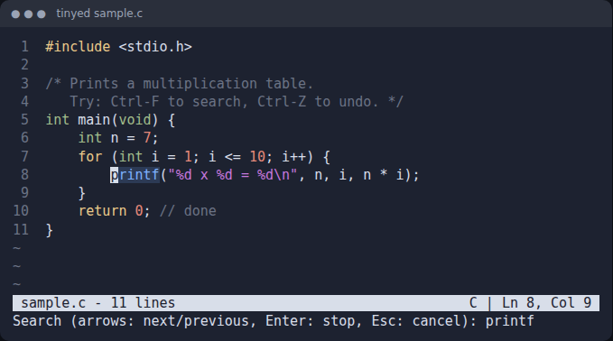

# tinyed

[](https://github.com/Sumitrcs/tinyed/actions/workflows/ci.yml) 

**A terminal text editor in about 1,500 lines of C, with no libraries, not even curses.** It has syntax highlighting for C, Python, JavaScript/TypeScript, Go and Rust, search as you type, undo and redo, auto-indent, and line numbers. It also saves safely, so a crash can never leave you with half a file.

Writing an editor is one of the best ways to learn how terminals really work: raw mode, escape codes, redrawing the screen, and turning key presses into commands.



*A real frame drawn by tinyed while searching. The match is highlighted, and the status bar shows the language and cursor position.*

## Build and run

```bash
make                    # → build/tinyed (Linux, gcc or clang)
./build/tinyed hello.c  # open a file (or a new one: it's created when you save)
make test               # 1,069 unit checks + 66 checks driving the real editor in a pseudo-terminal
make sanitize           # the same tests under AddressSanitizer + UBSan
```

| Key | Action | Key | Action |
|---|---|---|---|
| Ctrl-S | save (asks for a name if new) | Ctrl-Z / Ctrl-Y | undo / redo |
| Ctrl-Q | quit (twice if there are unsaved changes) | Ctrl-K | cut the current line |
| Ctrl-F | search; arrows go to the next/previous match | Ctrl-G | go to line |
| Arrows, Home, End, PgUp, PgDn | move | Ctrl-Left / Ctrl-Right | move by word |

## How it works

```text
src/term.c     raw mode, window size, decoding key presses
src/buffer.c   the text: rows, insert/delete, undo/redo, search, load/save
src/syntax.c   highlighting rules and the highlighter
src/editor.c   cursor, scrolling, drawing, prompts, commands
```

Only `term.c` and `editor.c` touch the terminal, so everything else is tested directly by `tests/test_core.c`.

### 1. Raw mode: getting every key press

By default a terminal is in *canonical* ("cooked") mode: it collects a whole line, shows what you type, and handles Backspace and Ctrl-C itself. Your program only sees the line after you press Enter.
An editor needs each key immediately, so `term_raw_on()` changes the terminal settings with `tcsetattr`:

```c
raw.c_lflag &= ~(ECHO | ICANON | IEXTEN | ISIG);  // don't echo, don't wait for Enter, Ctrl-C is a normal key
raw.c_iflag &= ~(IXON | ICRNL ...);              // Ctrl-S/Ctrl-Q are keys, not flow control
raw.c_oflag &= ~OPOST;                           // we write "\r\n" ourselves
raw.c_cc[VMIN] = 0; raw.c_cc[VTIME] = 1;         // read() waits at most 0.1 s
```

`atexit()` restores the original settings, so your shell works normally again even if the editor exits on an error.

### 2. Keys arrive as escape sequences

Letters arrive as one byte, and Ctrl plus a letter is that letter's code with the top bits cleared (`Ctrl-S` = 19).
Special keys send several bytes starting with Escape (27): the Up arrow sends `ESC [ A`, and Delete sends `ESC [ 3 ~`. `key_decode()` matches these against a table. It's a pure function (bytes in, key code out), so it's easy to test.

### 3. Drawing with escape codes

The screen is controlled by printing escape sequences too:

```text
ESC[H        move the cursor to the top left       ESC[K       clear to the end of the line
ESC[12;5H    move it to row 12, column 5           ESC[7m      inverse video (the status bar)
ESC[33m      yellow text (a keyword)               ESC[?25l    hide the cursor while drawing
```

Every frame, tinyed builds the whole screen in memory (line numbers, visible text, status bar, message) and sends it with a **single `write()`**. Sending many small writes would make the screen flicker as it's drawn piece by piece.
tinyed also switches to the terminal's *alternate screen* (`ESC[?1049h`), like vim and less do, so your shell's text reappears when you quit.

### 4. The text: rows, and two operations

The file is an array of rows. Each row keeps its bytes (`chars`) and a `render` version with tabs expanded to spaces, because the cursor's position in the bytes and on the screen differ:

```text
chars:   \t r e t u r n           cursor at byte 1 ("r")
render:  · · · · r e t u r n      ...is drawn at column 4
```

UTF-8 needs the same care. `é` is 2 bytes but 1 column, so moving left or right skips "continuation bytes" (those that look like `10xxxxxx`).

Every edit goes through just two functions: `buf_insert(position, text)`, where the text may contain newlines that split rows, and `buf_delete(from, to)`, which may join rows. Typing, Enter, Backspace, Delete, Ctrl-K, undo and redo are all built from these two.

### 5. Undo and redo

Each change is recorded as *"inserted TEXT at POSITION"* or *"deleted TEXT at POSITION"*. To undo, do the opposite: delete what was inserted, or insert what was deleted. The record then moves to the redo stack. Making a new change clears the redo stack, as in every editor.

Undoing one letter at a time would be annoying, so consecutive typing is **grouped**: if a new insert starts exactly where the last one ended, it is added to the same record. Moving the cursor or pressing Enter starts a new group, and Backspace and Delete are grouped the same way.
A test makes 300 rounds of 50 random edits, then checks that undoing everything gives back the exact original text and redoing everything gives back the edited text.

### 6. Syntax highlighting: a little state machine

Each row is scanned left to right, deciding a color for each character. Are we inside a string? Then everything is a string until the matching quote, except that `\"` doesn't end it. Does a comment start here? Then the rest of the line is a comment. Does a keyword start here? Only if it's a whole word: `if` is a keyword, but the "if" in `iff` isn't.

The only state that crosses lines is **"inside a `/* ... */` comment"**. Each row remembers whether it ends inside one. When that changes (say, you type `/*` at the top of a file), the next row is highlighted again, then the next, for as long as the change keeps rippling down.

### 7. Saving safely

`buf_save()` writes the text to `file.tinyed~`, calls `fsync()` so it's really on disk, then `rename()`s it over the original. A rename is atomic: if the power fails at any moment, you have either the old file or the new one, never half of each. The original file's permissions are kept.
tinyed also remembers whether the file ended with a newline and whether it used Windows `\r\n` line endings, and saves it the same way.

## How it's tested

- **`tests/test_core.c`** (1,069 checks) covers insert and delete across lines, undo grouping, random edit/undo/redo sequences, UTF-8 cursor movement, tab columns, search with wrap-around in both directions, highlighting of every token type including multi-line comments that open and close, key decoding, and files with and without a final newline or with CRLF endings, all round-tripped byte for byte.
- **`tests/test_terminal.py`** (66 checks) runs the real editor in a **pseudo-terminal**, the same mechanism `ssh` and terminal emulators use. It types keys, and a small screen model replays the escape codes so the test can read the screen as text. It checks drawing, saving, auto-indent, quitting with unsaved changes, undo, search, go to line, horizontal scrolling, resizing the window, UTF-8 editing and Save As.
- Both run under **AddressSanitizer and UndefinedBehaviorSanitizer** in CI, with gcc and clang. Any memory error, leak or undefined behaviour fails the build.

## Limits

Characters that take two columns (Chinese, Japanese and most emoji) and combining marks (as in Hindi) can make the cursor drift from the text. Files are held fully in memory, and there's no mouse support or copy/paste between lines beyond Ctrl-K.
These are good exercises.

## What you'll learn

- How terminals work: canonical vs raw mode, `termios`, escape sequences, the alternate screen, `SIGWINCH` for resizes
- Building a screen-drawing loop without flicker
- Data structures for text: rows, byte vs screen columns, UTF-8
- Undo/redo as a list of reversible operations, and grouping them
- Writing a small highlighter as a state machine
- Crash-safe saving with `fsync` and atomic `rename`
- Testing an interactive program through a pseudo-terminal, and using sanitizers

## Try it yourself

1. **Copy and paste.** Make Ctrl-K collect consecutive cut lines into a clipboard and add Ctrl-U to paste them, as nano does.
2. **Search and replace.** After Ctrl-F finds a match, let Ctrl-R replace it, and make each replacement one undo step.
3. **Wide characters.** Use `wcwidth()` so Chinese characters and emoji take two columns.
4. **A new language.** Add highlighting for Java or shell scripts. It's only a table in `syntax.c`.
5. **A gap buffer.** Replace each row's `chars` with a gap buffer and measure the difference on a 10 MB single-line file.

## License

MIT © Sumit ([@Sumitrcs](https://github.com/Sumitrcs))
