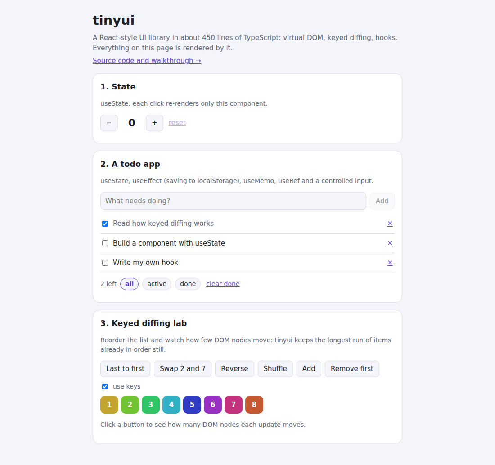

# tinyui

[](https://github.com/Sumitrcs/tinyui/actions/workflows/ci.yml) 

**A React-style UI library built from scratch in about 450 commented lines of TypeScript.** It has a virtual DOM, keyed diffing that moves the fewest possible DOM nodes, function components, hooks (`useState`, `useEffect`, `useMemo`, `useCallback`, `useRef`, `useReducer`) and batched updates.

If you use React, Vue or Preact, this is the part that usually feels like magic, small enough to read in an evening. **[Live demo](https://sumitrcs.github.io/tinyui/)**: a counter, a todo app, and a "keyed diffing lab" that counts how many DOM nodes each update moves.



```ts
import { h, render, useState } from "./src/tinyui.ts";

function Counter() {
  const [count, setCount] = useState(0);
  return h("button", { onClick: () => setCount((c) => c + 1) }, `Clicked ${count} times`);
}

render(h(Counter, null), document.getElementById("app")!);
```

`h(type, props, ...children)` is what JSX compiles to: `<b class="x">hi</b>` becomes `h("b", { class: "x" }, "hi")`.

## Run it

```bash
npx serve .          # then open http://localhost:3000 for the demo
npm test             # 31 tests, in Node, with a small fake DOM
node build.mjs       # rebuild dist/ after editing src/ (strips the TypeScript types)
```

No bundler or dependencies are needed. Node 22.18+ runs the `.ts` files directly.

## How it works

### 1. The virtual DOM is just objects

`h("li", { key: 3 }, "Milk")` returns a plain object:

```js
{ type: "li", props: {}, key: 3, children: [{ type: TEXT, text: "Milk" }] }
```

A component is a function that returns such objects. Building them is cheap, much cheaper than touching the real DOM, so tinyui can afford to rebuild the whole tree on every update and then work out what changed.

### 2. Instances remember what's on screen

Each mounted vnode gets an **instance** that holds its real DOM node, its child instances and, for components, its hooks. When a new tree arrives, it's compared with these instances:

- **same type and key**: keep the DOM node and update only the props that changed (`setProps` compares old and new). If only one number changed, the test suite checks that exactly one DOM operation happened;
- **different type**: `<p>` became `<section>`, so build new DOM and remove the old;
- **component**: call the function again with the new props, then compare what it returned.

A component that renders nothing still leaves an empty comment node in the DOM. That way every instance has a place in the page, and the code never has to ask where the nothing was.

### 3. Lists and keys: the clever part

Say the list `a b c d` becomes `d a b c`. The naive way patches by position: `a→d`, `b→a`, `c→b`, `d→c`. That changes four texts, and if those `<li>`s had state or focus, it would end up on the wrong items.

With **keys**, tinyui matches children by identity instead: `d` is still the same `d`, it has just moved. Next it decides which nodes to move. For each new child it looks up its old position:

```text
new order:      d  a  b  c
old position:   3  0  1  2
```

Any **increasing** run in that list is already in the right relative order. The **longest increasing subsequence** (`0 1 2`, which is `a b c`) can stay where it is, and only the rest moves. Here that's one `insertBefore` for `d`, instead of three or four. The subsequence is found in O(n log n) with binary search, the same trick Vue 3 and Inferno use.

```text
abcd → dabc   1 move        abcde → aecdb   2 moves
abcd → dcba   3 moves       abcd  → abcd    0 moves
```

These counts are asserted in the tests, and 300 random shuffles check that the result is always right. The demo's lab shows the count live, measured by a `MutationObserver` in the real browser.

### 4. Hooks are an array

How does `useState` know which state is yours, when it's just a function call? Each component instance has an array of hooks, and a counter that resets to 0 before each render. The first `useState` call gets slot 0, the second slot 1, and so on.
That's why **hooks must be called in the same order every time**, never inside an `if`: otherwise the third call would find the second slot's data.

- `useState`: the slot holds the value and a setter. The setter stores the new value and marks the component dirty.
- `useEffect(fn, deps)`: the slot holds the deps and the cleanup. After rendering, if any dependency changed (compared with `Object.is`), the old cleanup runs and then the effect.
- `useMemo` / `useCallback`: recompute only when deps change.
- `useRef`: a `{ current }` box that survives renders without causing them.

### 5. Batching

Calling `setCount` three times in one click handler doesn't render three times. Updates are collected in a set and rendered once, a moment later, in a **microtask** (`queueMicrotask`). Dirty components render parents-first, since rendering a parent re-renders its children anyway. A test checks that two updates cause exactly one render.

### 6. Events, inputs and styles

- **Events**: there's one real listener per event type per element, which calls whatever handler the latest render provided. Changing `onClick` on every render doesn't add or remove any listeners.
- **`value` and `checked`** are set as *properties*, not attributes (the attribute is only the initial value). They're compared with the live element, so a controlled input always shows the state.
- **Styles** can be objects: `{ fontSize: 14 }` becomes `font-size: 14px`, while unitless properties like `opacity` and custom properties like `--hue` are left alone.

## Differences from React

React is far bigger for good reasons: it can pause rendering to keep the page responsive (the *Fiber* architecture), it has context, Suspense, server rendering and a synthetic event system, and it handles countless browser quirks. tinyui doesn't have those. `onChange` here is the browser's native `change` event (React's fires on every keystroke, so use `onInput`), and effects run right after the DOM update.

## What you'll learn

- What a virtual DOM is, and why rebuilding objects is cheaper than touching the DOM
- Reconciliation: matching old and new trees by type and key
- Why keys matter, and the longest-increasing-subsequence trick for the fewest DOM moves
- How hooks work underneath: an array per component, and the "rules of hooks" explained
- Batching updates with microtasks, and effect cleanup order
- Testing UI code in Node with a fake DOM that also counts operations

## Try it yourself

1. **Context.** Add `createContext` and `useContext`, so a theme can be passed down without props. Hint: walk up `inst.parent`.
2. **`memo()`.** Skip re-rendering a component when its props are shallowly equal to last time.
3. **SVG.** Elements inside `<svg>` must be created with `document.createElementNS`. Pass a namespace down while mounting.
4. **JSX.** Add `/** @jsx h */` and compile the demo with `esbuild --jsx-factory=h`.
5. **Error boundaries.** Catch an exception from a child component and render a fallback instead of breaking the page.

## License

MIT © Sumit ([@Sumitrcs](https://github.com/Sumitrcs))
