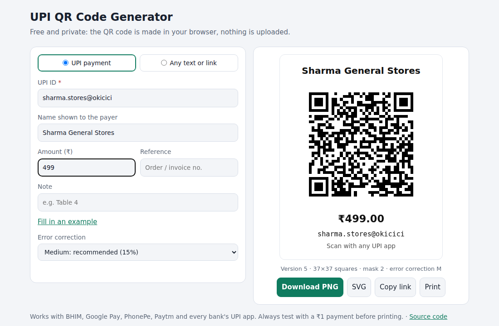

# UPI QR Code Generator

[](https://github.com/Sumitrcs/upi-qr/actions/workflows/ci.yml) 

Make a **"Scan & Pay" QR code** for your shop, stall or invoice in a few seconds.
It works with every UPI app and can carry an optional fixed amount. You can download it as PNG or SVG, or print it as a standee.

The QR encoder itself is **written from scratch in TypeScript**, including the Reed–Solomon error correction and the mask scoring, with **zero dependencies**.
Everything runs in your browser, and nothing is uploaded.

**Live:** https://sumitrcs.github.io/upi-qr/



## Features

- **UPI payment QR**: UPI ID, payee name, optional amount, note and reference. It produces a standard `upi://pay` link that BHIM, Google Pay, PhonePe, Paytm and bank apps all understand.
- UPI ID and amount checks with friendly messages, and a warning above the usual ₹1 lakh limit
- **Any text or link** mode for Wi-Fi notes, menus, websites, and anything else
- Four error-correction levels. Level H still scans with about 30% of the code covered.
- Crisp PNG (about 1000 px), scalable SVG, copy link, and a print layout that fits on A4
- Works offline, dark mode, mobile friendly, and remembers your details on this device

## Run it

```bash
npx serve .            # then open http://localhost:3000
npm test               # 17 tests, no dependencies (Node 22.18+ runs .ts directly)
node build.mjs         # src/*.ts → dist/*.js for the browser
```

## Use the encoder in your own code

```ts
import { encodeText, toSvg } from "./src/qr.ts";
import { buildUpiLink } from "./src/upi.ts";

const link = buildUpiLink({ vpa: "sharma.stores@okicici", name: "Sharma Stores", amount: 250, note: "Order 42" });
// upi://pay?pa=sharma.stores@okicici&pn=Sharma%20Stores&am=250.00&cu=INR&tn=Order%2042

const qr = encodeText(link, { level: "M" });
qr.version; // 5: a 37×37 grid
qr.mask;    // 4: whichever of the 8 masks scored best
document.body.innerHTML = toSvg(qr);
```

## How it works

### The UPI part is just a link

Every UPI QR code contains plain text like this:

```text
upi://pay?pa=sharma.stores@okicici&pn=Sharma%20Stores&am=250.00&cu=INR&tn=Order%2042
          └── UPI ID ─────────────┘ └── name ──────────┘ └ amount ┘ └ ₹ ┘ └─ note ───┘
```

`src/upi.ts` builds that link and escapes spaces, `&` and Hindi text properly. It also parses links back, which is useful for checking a QR code someone gave you.
The interesting part is turning text into the black-and-white squares.

### Making a QR code, in five steps (`src/qr.ts`)

**1. Text → bits.** The first 4 bits say "bytes follow" (`0100`), the next 8 or 16 bits give the length, and then come the UTF-8 bytes.
After that, the standard pad bytes `11101100` and `00010001` fill the space up to the chosen version's capacity.
The *version* (1 to 40) is the size: version 1 is 21×21 squares, and each version adds 4 squares per side.

**2. Reed–Solomon error correction.** This is the clever part. The data bytes are treated as the coefficients of a polynomial and divided by a fixed "generator" polynomial.
The **remainder** of that division becomes extra bytes appended to the data. A scanner can use them to rebuild bytes that are missing or wrong.
The arithmetic happens in a special number system with only 256 values (a *Galois field*), in which addition is XOR:

```ts
function gfMultiply(x, y) {          // multiply in GF(256)
  let z = 0;
  for (let i = 7; i >= 0; i--) {
    z = (z << 1) ^ ((z >>> 7) * 0x11d);   // keep the result inside 0..255
    z ^= ((y >>> i) & 1) * x;
  }
  return z;
}
```

Larger codes split the data into several blocks and then **interleave** them: byte 0 of each block, then byte 1 of each block, and so on. A coffee stain then damages a little of many blocks instead of all of one, and each block can repair itself.

**3. Fixed patterns.** The three big corner squares tell a camera where the code is and which way up it is.
A dotted *timing* line in row 6 and column 6 gives the grid spacing. Small *alignment* squares correct for a bent or tilted page.
Format bits record the error level and the mask, and they are protected by their own little error-correcting (BCH) code.

**4. Placing the bits.** The bits snake through the free squares two columns at a time, starting at the bottom-right corner and alternating up and down.

**5. Masking.** Data can accidentally form big blank areas or shapes that look like a corner square, and those confuse scanners.
So the encoder tries **all 8 mask patterns**: XOR the data with a checkerboard, stripes and so on, then score each result with the four penalty rules from the standard. The one with the lowest score wins.

## How it was tested

A QR code that *looks* right can still be wrong, so the encoder was checked two ways during development:

- **Bit-for-bit against an independent encoder.** I compared 911 random codes across all 40 versions, 4 levels and 8 masks with the Python library segno. Every module was identical. One quirk turned up along the way: segno adds an unneeded zero pad byte when the data already ends on a byte boundary. The standard doesn't call for it, scanners ignore it either way, and once it was set aside the outputs matched exactly.
- **Scanned by a real decoder.** 286 codes from the encoder (UPI links with Hindi names and emoji, random text, versions 1–39, every mask) were rendered as images and decoded with zxing, the library inside many phone scanners. 286 out of 286 decoded correctly. So did the QR codes drawn by the page in the browser and the downloaded PNG.

The unit tests (`npm test`) cover the parts with known answers:
- the Reed–Solomon worked example from the standard's tutorial material
- the alignment-pattern table and the format-information strings
- capacity limits, including the largest QR code: version 40-L, 2,953 bytes
- a complete version 1 code compared module by module

## What you'll learn

- How QR codes really work: modes, versions, error levels, masks
- Arithmetic in a finite field (GF(256)) and polynomial division, which is the maths behind Reed–Solomon codes. The same codes protect CDs, DVDs, satellite links and RAID.
- How to verify an encoder: against an independent implementation, and with a real decoder
- The UPI deep-link format used across Indian payment apps, and safe URL encoding
- Writing TypeScript that runs directly in Node and builds for the browser with no tooling (`build.mjs`)
- Canvas and SVG output, print CSS, and `localStorage` that fails safely

## Try it yourself

1. **Alphanumeric mode.** Text that is only `0–9 A–Z $%*+-./:` and spaces can be packed at 5.5 bits per character instead of 8. Add that mode and watch the version drop for `HTTPS://EXAMPLE.COM`.
2. **Logo in the middle.** At level H, paint a small logo over the centre squares, then check that your phone still scans it. How big can the logo get?
3. **Colours.** Add a colour picker for the dark squares, and warn when the contrast with the background is too low to scan.
4. **Batch mode.** Paste a CSV of names and amounts and download one PNG per row (for fee collection, say).
5. **Read it back.** Implement the decoder side for an image you load: find the corner squares, sample the grid, unmask, and run Reed–Solomon *decoding* (the harder half).

*This tool only creates the QR code. The payment itself happens in the payer's UPI app, so always test with ₹1 before printing.*

## License

MIT © Sumit ([@Sumitrcs](https://github.com/Sumitrcs))
