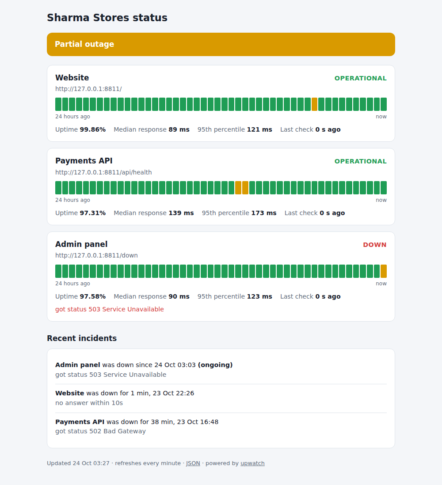

# upwatch

[](https://github.com/Sumitrcs/upwatch/actions/workflows/ci.yml) 

**A self-hosted uptime monitor and status page in Go, as one binary with no dependencies.** It checks your websites and APIs every few seconds or minutes, sends an alert to Slack, Discord or any webhook when something goes down (and again when it's back), and serves a status page like the ones GitHub and Stripe show their users.



*The status page with three checks. The current results are live; the earlier 24 hours of history were loaded from a sample data file.*

## Quick start

```bash
go install github.com/Sumitrcs/upwatch/cmd/upwatch@latest
cp upwatch.example.json upwatch.json      # edit the checks
upwatch -config upwatch.json              # status page on http://localhost:8080/
```

```json
{
  "title": "Sharma Stores status",
  "listen": ":8080",
  "data_file": "upwatch-history.jsonl",
  "webhook": "https://hooks.slack.com/services/…",
  "checks": [
    { "name": "Website", "url": "https://example.com/", "interval": "1m", "expect_text": "Example Domain" },
    { "name": "Payments API", "url": "https://example.com/api/health", "interval": "30s", "timeout": "5s", "expect_status": 200 },
    { "name": "Admin panel", "url": "https://example.org/", "interval": "5m", "failures_before_down": 3 }
  ]
}
```

| Field | Meaning | Default |
|---|---|---|
| `interval` | how often to check | `1m` |
| `timeout` | how long to wait for the full response | `10s` |
| `expect_status` | the exact status code that means "up" | any 2xx or 3xx |
| `expect_text` | text the page must contain, which catches "200 OK, but showing an error" | none |
| `failures_before_down` | failures in a row before the check counts as down | `2` |

A typo in the config, like `"intreval"`, is an error rather than being silently ignored, and every problem is reported at once.

### Check once, for cron or CI

```text
$ upwatch -config upwatch.json -once
UP    Website       2 ms    200
UP    Payments API  123 ms  200
DOWN  Admin panel   2 ms    got status 503 Service Unavailable
$ echo $?
1
```

The exit status is 1 if anything is down, so `upwatch -once` can gate a deployment or send a cron email.

### Alerts

When a check changes state, upwatch POSTs JSON to the `webhook` URL:

```json
{"text": "🔴 Payments API is DOWN: got status 502 Bad Gateway",
 "content": "🔴 Payments API is DOWN: got status 502 Bad Gateway",
 "check": "Payments API", "from": "up", "to": "down", "time": "2026-10-24T12:00:00Z",
 "reason": "got status 502 Bad Gateway"}
```

Slack and Google Chat show `text`, Discord shows `content`, and your own programs can read the other fields.

### Endpoints

- `/`: the status page, which refreshes every minute
- `/api/status`: the same information as JSON (uptime, median and 95th percentile response times in ms, last result, incidents)
- `/healthz`: says `ok`, so you can monitor the monitor

## How it works

```text
config.go    reading and validating the JSON config
probe.go     one check: GET the URL, decide up or down, explain errors
monitor.go   running checks on a schedule, up/down state, incidents, 24-hour summary
store.go     saving history as JSON Lines and reading it back after a restart
notify.go    webhook alerts
server.go    the status page (html/template) and JSON API
```

### 1. One goroutine per check

Each check runs in its own goroutine, a lightweight thread managed by Go. It probes once immediately, then waits for a `time.Ticker`:

```go
for {
    r := Probe(ctx, m.Client, c)
    m.Record(c.Name, r)
    select {
    case <-ctx.Done(): return     // Ctrl-C: stop
    case <-ticker.C:              // time for the next check
    }
}
```

A slow site can't delay the others, and a hundred checks cost a hundred tiny goroutines. Results from all goroutines go into one `Monitor`, so its data is protected by a `sync.Mutex`, and the tests run under Go's race detector (`go test -race`) to prove it.

### 2. What counts as "up"

A probe is a GET request with a deadline (`context.WithTimeout`). It's up only if:

- an answer arrives within the timeout. The body is read too, because a server that sends headers and then hangs isn't really up;
- the status code is right (an exact match, or anything below 400);
- the page contains `expect_text`, if set. Many broken sites happily return `200 OK` with "Database error" in the page.

Go's network errors are turned into plain words: `connection refused (is the server running?)`, `can't find the server shop.example (DNS)`, `no answer within 10s`.

### 3. Don't cry wolf: state changes and incidents

One failed request is often just a network blip. A check only goes **down** after `failures_before_down` failures in a row (2 by default), and goes **up** again on the first success. Only these state changes send alerts, so you get one message when the site goes down and one when it recovers, not one every minute.
Each down period becomes an **incident** with a start, an end and a reason.

### 4. Uptime, bars and percentiles

The status page summarises the last 24 hours:

- **Uptime** = successful checks ÷ all checks. It's rounded *down*, so 99.996% shows as 99.99%, never as a reassuring but false 100.00%.
- **48 bars** of 30 minutes each: green if every check in that half hour passed, amber if some failed, red if all failed, grey with no data.
- **Response time percentiles.** The *median* (p50) is the typical response; the *95th percentile* (p95) is the time 95% of responses beat. Averages hide slow outliers, which is why monitoring tools use percentiles. upwatch uses the *nearest-rank* method: sort the values and take the one at position ⌈p/100 × n⌉.

### 5. Remembering across restarts

With `data_file` set, every result is appended to a JSON Lines file, one JSON object per line:

```json
{"check":"Website","time":"2026-10-24T03:26:42.09Z","ok":true,"status":200,"latency":3644507}
```

Appending is cheap, and a crash can at most cut off the last line, which is skipped when reading back. On start, the file is **replayed** through the same `Record` function, so states and incidents are rebuilt exactly. Alerts are switched off during the replay, so a restart doesn't re-announce yesterday's outage.

### 6. A safe status page

The page uses Go's `html/template`, which escapes everything it inserts. A check named `<script>alert(1)</script>` is displayed as text instead of running in visitors' browsers; that's *cross-site scripting* (XSS), and a test checks it. The template is compiled into the binary with `//go:embed`, so there's one file to deploy.

## How it's tested

17 tests, run with `-race`. They cover:

- probes against real local HTTP servers (`httptest`): expected text, wrong status, 404, timeouts, redirects and redirect loops, refused connections and unknown hosts;
- state changes: blips that don't trigger alerts, down after N failures, recovery, and incidents with exact start and end times;
- the 24-hour summary with a fake clock: uptime, all 48 bars, percentiles, and a check with no data yet;
- the running scheduler against a server that goes down and comes back;
- the status page and JSON API, including HTML escaping;
- webhooks, saved history surviving a restart (including a half-written last line), config validation, and the `-once` command's output and exit code.

## What you'll learn

- Go concurrency: goroutines, `time.Ticker`, `select`, `context` cancellation, `sync.Mutex`, `sync.WaitGroup`, and the race detector
- HTTP clients done right: timeouts, reading the body, redirects, and interpreting network errors
- Monitoring ideas: debouncing alerts, incidents, uptime percentages, and why percentiles beat averages
- Web servers in the standard library: Go 1.22+ routing patterns (`GET /api/status`), `html/template`, `embed`, graceful shutdown
- Append-only logs (JSON Lines) and rebuilding state by replaying events
- Testing networked code with `httptest` and an injectable clock

## Try it yourself

1. **TLS certificate expiry.** Look at `resp.TLS.PeerCertificates[0].NotAfter` and warn 14 days before a certificate expires.
2. **TCP and ping checks.** Add `"type": "tcp"` to check that a database port accepts connections.
3. **Email alerts.** Send alerts with `net/smtp` as well as webhooks.
4. **Compact the history file.** It grows forever. On start, rewrite it keeping only the last two days.
5. **Response time chart.** Add a small SVG line chart of p95 per half hour to each card.

## License

MIT © Sumit ([@Sumitrcs](https://github.com/Sumitrcs))
